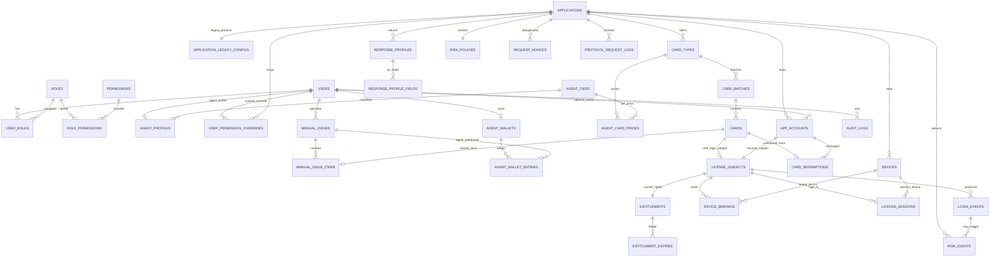
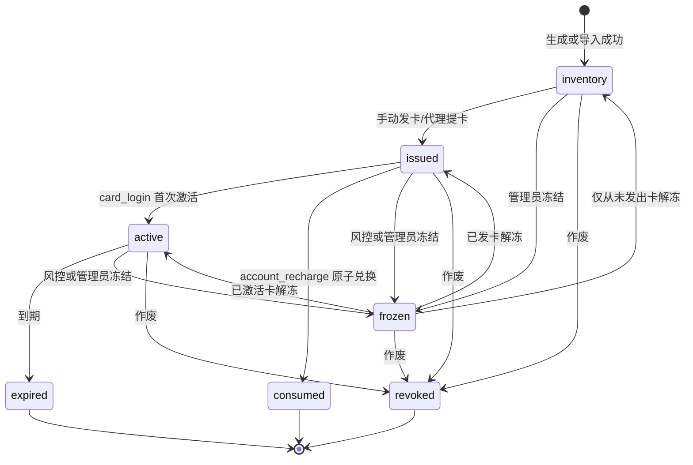
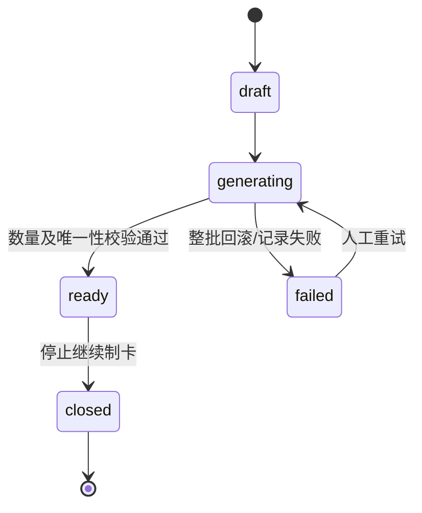
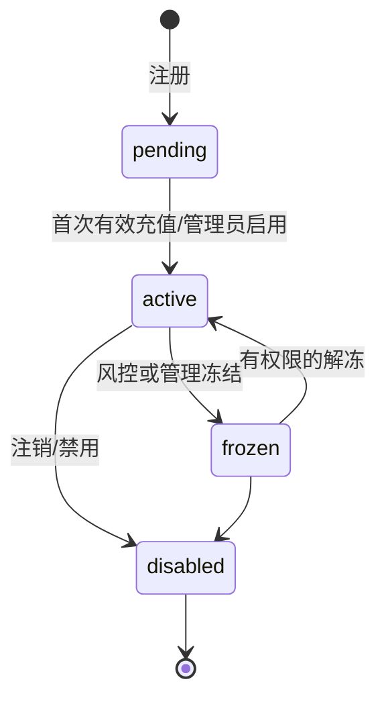
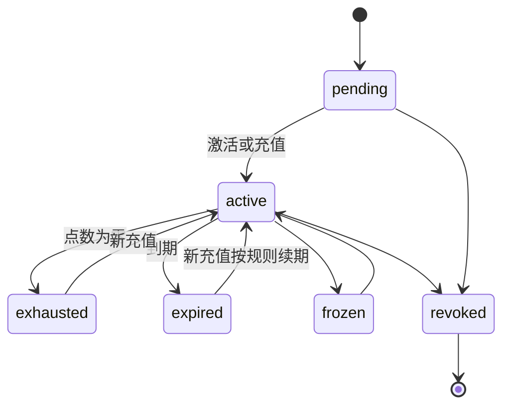
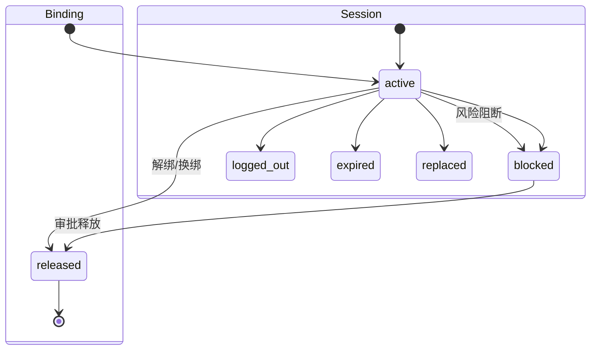
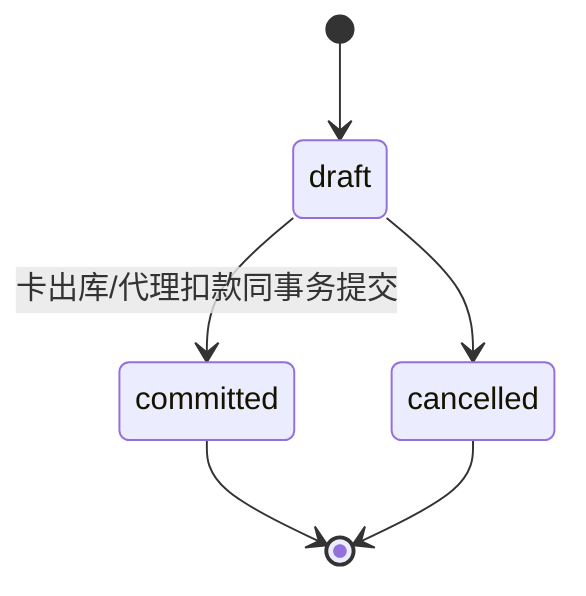

# MyBsPHP2 数据库设计（W0-6）

> 状态：**DONE（W0 设计基线 v1 已冻结）**  
> 目标技术：Laravel 13 + PHP 8.3 + MySQL 8 / InnoDB / `utf8mb4`  
> 时间约定：业务时间统一保存为 UTC `DATETIME(6)`，展示时按站点时区转换。  
> 范围约定：本文件只定义首版逻辑模型与迁移边界，不包含 Migration 或业务代码。

## 1. 设计目标与旧版映射

新版保留旧 BSPHP 中有价值的业务含义，但不复制其 MyISAM、弱关联和重复字段设计：

| 旧版概念 | 旧表 | 新版归属 |
|---|---|---|
| 管理员及权限串 | `bs_php_admin`、`bs_php_list_admin` | `users` + RBAC 表 + 权限覆盖 |
| 软件和通信配置 | `bs_php_appinfo`、`bs_php_appini` | `applications`、`application_legacy_configs` |
| 卡种和卡库存 | `bs_php_kalei`、`bs_php_cardseries` | `card_types`、`card_batches`、`cards` |
| 卡密授权 | `bs_php_pattern_car` | `license_subjects`、`entitlements`、设备/会话表 |
| 账户授权 | `bs_php_pattern_login`、`bs_php_user` | `app_accounts`、`license_subjects`、`entitlements` |
| 在线连接 | `bs_php_links_session` | `license_sessions` |
| 接口和管理日志 | `bs_php_appen_log`、`bs_php_log` | `protocol_request_logs`、`audit_logs`、`risk_events` |
| 统计汇总 | `bs_php_today_appuser_ka` | 首版由事件表查询；需要时增加可重建的日汇总表 |

关键改进：

1. 全部业务表使用 InnoDB、外键、事务和明确的唯一约束。
2. 角色权限不再存为字符串；使用 RBAC，并为代理增加应用级允许/拒绝覆盖。
3. 卡密登录和账户充值共享授权主体、权益、设备绑定、会话与风控模型。
4. Legacy 参数名、编码器和响应位置全部配置化，但敏感密钥不以明文保存。
5. 卡密、余额、充值和发卡记录通过不可变流水追踪，不依赖覆盖式字段。
6. 对外 ID 使用 ULID，内部关联使用 `BIGINT UNSIGNED` 主键。

## 2. 首版边界

### 2.1 包含

- 管理员、普通后台操作员、代理、普通用户。
- `card_login`：一次性卡密作为登录凭证，首次成功时激活并可绑定设备。
- `account_recharge`：应用账户注册/登录，充值卡一次性兑换时长或点数。
- 应用、Legacy 参数、响应档案和固定 `arr[0/1/2/3/4/6/8]` 契约。
- 卡种、制卡批次、卡密、手动发卡、代理余额及代理提卡。
- 设备、激活、在线会话、登录事件。
- 风险策略、Nonce、防重放记录、风险事件。
- 管理操作审计和重要业务流水。

### 2.2 明确排除

首版不建立下列表或字段：

- 支付订单、支付渠道、支付回调、退款、补单、自动发货。
- 邮箱地址、邮件任务、邮件验证码。
- 手机短信验证码、图形验证码。
- 邀请、推广、佣金和返佣。

“管理员手动给代理增加余额”属于内部账务调整，不属于在线支付。

## 3. 总体 ER 图

为保持可读性，图中只画核心关系；RBAC、日志和配置的全部字段见后文表清单。



## 4. 通用字段和类型规则

除纯关联表外，主要表默认包含：

| 字段 | 类型 | 规则 |
|---|---|---|
| `id` | `BIGINT UNSIGNED` | 自增主键，只用于库内关联 |
| `public_id` | `CHAR(26)` | ULID，对外展示，唯一 |
| `created_at` / `updated_at` | `DATETIME(6)` | UTC |
| `deleted_at` | `DATETIME(6) NULL` | 仅适用于允许软删除的配置/主体表 |
| `lock_version` | `INT UNSIGNED` | 对余额、权益等热点行做可选乐观锁 |

约束规则：

- 状态和类型使用 `VARCHAR` + 应用层枚举；关键组合再加 MySQL 8 `CHECK`。
- IP 使用 `VARBINARY(16)`，兼容 IPv4/IPv6；展示时转换。
- 金额统一用 `BIGINT` 的分（`*_cents`），不使用 `FLOAT/DOUBLE/DECIMAL` 做余额。
- 点数使用 `BIGINT`；时长使用 `BIGINT UNSIGNED duration_seconds`。
- 密码使用 Laravel Password Hasher 生成的 `VARCHAR(255)`。
- 可检索秘密使用服务端 pepper 的 HMAC-SHA-256，保存为 `BINARY(32)`。
- 需要再次展示的卡号另存加密密文 `TEXT`，密钥来自环境/KMS；日志只保留末四位。
- JSON 配置使用 MySQL `JSON`，但需要筛选、唯一或外键的数据必须拆列。
- 外键默认 `RESTRICT`；纯关联记录可 `CASCADE`；审计/流水绝不级联删除。

## 5. 身份、角色和代理

### 5.1 `users`

后台和站点身份。一个身份可同时拥有多个角色；应用内登录账户另存 `app_accounts`。

关键字段：

- `public_id`、`username`、`password_hash`。
- `status`：`active | suspended | disabled`。
- `secondary_password_hash NULL`：独立哈希，不复用主密码字段。
- `secondary_password_required BOOLEAN DEFAULT FALSE`：账号级必需标记。
- `secondary_password_changed_at DATETIME(6) NULL`：最近设置、修改或重置时间。
- `last_login_at`、`last_login_ip`、`failed_login_count`、`locked_until`。
- `session_version`：修改密码/冻结时递增，使现有 Web Session 失效。
- `created_by_user_id NULL`、`deleted_at`。

索引/约束：

- `UNIQUE(username)`，统一使用确定的大小写归一规则。
- `INDEX(status, deleted_at)`。
- 不含 `email`、邮箱验证或验证码字段。

### 5.2 RBAC 表

| 表 | 关键字段与约束 |
|---|---|
| `roles` | `code UNIQUE`、`name`、`is_system`；预置 `super_admin/admin/agent/user` |
| `permissions` | `code UNIQUE`、`module`、`description` |
| `user_roles` | `user_id`、`role_id`，复合主键/唯一 `(user_id, role_id)` |
| `role_permissions` | `role_id`、`permission_id`，复合主键/唯一 |
| `user_permission_overrides` | `user_id`、`permission_id`、`effect allow/deny`、`application_id NULL`、`card_type_id NULL`、`expires_at NULL`；唯一覆盖范围 |

W3-2 正式实现说明：

- 后台身份已由独立 `administrators` 表承载，因此后台角色关联表落地为
  `administrator_roles`。
- `administrator_roles` 使用 `(administrator_id, role_id)` 复合主键，并记录分配人。
- `permissions` 额外记录 `risk_level` 与 `agent_assignable`，供后续代理模板和高影响权限
  规则使用。
- `user_roles` 与用户级覆盖保留到应用账户/代理身份阶段实施。

权限判定优先级：

```text
super_admin
  > 用户级 scoped deny
  > 用户级 scoped allow
  > 角色权限
  > 默认拒绝
```

代理默认可授予：

- 查看被授权应用/卡种。
- 查看自己的库存、发卡记录、余额和流水。
- 按等级价提卡和将自己库存中的卡手动交付。

代理默认明确不授予：

- `cards.delete`、`cards.revoke_any`。
- `devices.unbind`、`devices.rebind_approve`。
- `app_accounts.manage`、`app_accounts.freeze`。
- `users.manage`、`agents.manage`、`permissions.manage`。
- 查看其他代理数据或全站审计。

### 5.3 代理表

| 表 | 关键字段与约束 |
|---|---|
| `agent_tiers` | `public_id`、`name`、`code UNIQUE`、`status`、`sort_order`、`deleted_at` |
| `agent_profiles` | `user_id UNIQUE`、`tier_id`、`parent_agent_user_id NULL`（未来多级代理预留；首版仅一级并强制为 NULL）、`status`、`note` |
| `agent_card_prices` | `tier_id`、`card_type_id`、`unit_price_cents`；`UNIQUE(tier_id, card_type_id)` |
| `agent_wallets` | `user_id UNIQUE`、`balance_cents BIGINT`、`lock_version` |
| `agent_wallet_entries` | `wallet_id`、`direction credit/debit`、`amount_cents > 0`、`balance_before_cents`、`balance_after_cents`、`reason`、`reference_type/reference_id`、`idempotency_key`、`operator_user_id` |

`agent_wallet_entries` 对 `(wallet_id, idempotency_key)` 建唯一索引。余额调整与流水写入必须在同一事务、同一钱包行锁中完成。

## 6. 应用、Legacy 协议与响应档案

### 6.1 `applications`

关键字段：

- `public_id`、`code UNIQUE`、`name`、`description`。
- `mode`：`card_login | account_recharge`。
- `entitlement_kind`：`duration | points | fixed_expiry`。
- `status`：`draft | active | suspended | archived`。
- `client_secret_hash`：REST/Legacy 身份校验散列。
- `encryption_key_ciphertext NULL`：只有协议加解密确实需要取回密钥时保存。
- `bind_device_enabled`、`max_bound_devices`、`max_concurrent_sessions`。
- `version_name NULL`、`announcement NULL`。
- `created_by_user_id`、`deleted_at`。

约束：

- `mode=card_login` 的登录主体来自登录卡。
- `mode=account_recharge` 的登录主体来自 `app_accounts`，充值卡只更新权益。
- `UNIQUE(code)`；`INDEX(status, mode)`。

### 6.2 `application_legacy_configs`

每个应用最多一条，保留旧版可改参数名和处理链配置：

- `application_id UNIQUE`。
- 参数名：`appid_param`、`signature_param`、`payload_param`、`api_param`、`session_param`、`date_param`、`mutual_key_param`、`credential_param`、`credential_secret_param`、`device_param`、`device_alt_param`、`appsafecode_param`。
- 默认值与处理器：`login_api_name`（默认 `login.ic`）、`request_decoder`、`response_encoder`、`output_wrapper`。
- `mutual_key_hash NULL`、`api_password_hash NULL`。
- `request_decryption_key_ciphertext NULL`、`response_encryption_key_ciphertext NULL`。
- `max_clock_skew_seconds`、`legacy_enabled`。
- `extra_config JSON`：只存非敏感、暂不需要检索的扩展参数。

参数名需符合 `[A-Za-z_][A-Za-z0-9_.-]{0,63}`。密钥密文不能出现在后台列表、请求日志或审计差异正文中。

### 6.3 `response_profiles`

用于按应用和客户端版本选择成功/失败返回：

- `public_id`、`application_id`、`name`。
- `purpose`：`login_success | login_failure | risk_decoy | risk_block`。
- `protocol`：`legacy_v1 | rest_v2`。
- `client_version_constraint NULL`。
- `wrapper`：`legacy_json | json | text`。
- `template`：例如 `{0}|{1}|{2}|{3}|{4}|{5}|{6}|{7}|{8}||`。
- `is_default`、`status`、`priority`、`deleted_at`。

唯一规则：

- 每应用、协议、用途最多一个无版本条件的默认档案。
- `UNIQUE(application_id, name, deleted_at)` 在 MySQL 对 NULL 的行为不足以保证业务唯一，Laravel Service 需配合事务检查；可另设不可空 `active_key` 生成列实现数据库强唯一。

### 6.4 `response_profile_fields`

字段逐项定义，避免直接执行后台输入：

| 字段 | 说明 |
|---|---|
| `response_profile_id`、`position` | `position` 为 0–N，`UNIQUE(profile_id, position)` |
| `source_type` | `constant | context | appsafecode_echo | daily_signature | payload | expires_at | device_id` |
| `source_key` | 上下文字段名；只允许白名单 |
| `constant_value_ciphertext NULL` | 需要保护的真实业务值 |
| `constant_value_preview NULL` | 后台安全预览 |
| `transformer` | `none | hex10 | timestamp | datetime | custom_registered` |
| `required`、`empty_value` | 缺失字段的行为 |

Legacy 成功基线必须固定：

| 位置 | 来源与规则 |
|---|---|
| `arr[0]` | 常量 `01` |
| `arr[1]` | 客户端标记，首版默认 `xx` |
| `arr[2]` | `payload`：真实业务值、空值，或风险策略选择的诱饵值 |
| `arr[3]` | `appsafecode_echo`，原样回传本次请求值，不从历史记录读取 |
| `arr[4]` | `daily_signature`，以应用密钥和 UTC 日期计算 |
| `arr[5]` | 常量 `1` |
| `arr[6]` | 当前权益到期时间；点数模式按档案约定输出 |
| `arr[7]` | 常量 `1` |
| `arr[8]` | 本次确认后的绑定设备标识 |

`arr[2]` 的真实值/空值配置属于普通成功档案；诱饵值必须来自 `purpose=risk_decoy` 档案。风险决策发生在响应组装前，并写入风险事件。

## 7. 卡种、批次、卡密与手动发卡

### 7.1 `card_types`

旧版“卡类/商品”的统一模型：

- `public_id`、`application_id`、`name`、`code`。
- `purpose`：`login_credential | account_recharge`。
- `benefit_kind`：`duration | points | fixed_expiry`。
- `duration_seconds`、`points_amount`、`fixed_expires_at` 三选一。
- `face_price_cents`、`default_agent_price_cents`。
- `code_prefix`、`code_length`、`secret_length`、`alphabet`。
- `status`：`draft | active | disabled`。
- `max_activations`（首版登录卡为 1）、`deleted_at`。

约束：

- `UNIQUE(application_id, code)`。
- `purpose` 必须与应用模式兼容：
  - `card_login` → `login_credential`。
  - `account_recharge` → `account_recharge`。
- `benefit_kind` 对应的值必须且只能有一个大于零；由 `CHECK` +领域校验共同保证。
- 价格按分保存；首版无线上收款，但用于代理提卡扣款和统计。

### 7.2 `card_batches`

- `public_id`、`card_type_id`、`batch_no UNIQUE`。
- `source`：`generated | imported`。
- `planned_quantity`、`actual_quantity`。
- `status`：`draft | generating | ready | closed | failed`。
- `created_by_user_id`、`generated_at NULL`、`closed_at NULL`、`note`、`deleted_at`。

批次仅在无卡时允许软删除。已有卡的批次只能 `closed`。

### 7.3 `cards`

- `public_id`、`batch_id`、`card_type_id`、`application_id`（冗余以便高频筛选，写入时校验一致）。
- `code_lookup_hash BINARY(32) UNIQUE`、`code_ciphertext TEXT`、`code_last4 CHAR(4)`。
- `secret_hash NULL`、`secret_ciphertext NULL`、`secret_last4 NULL`。
- `status`：`inventory | issued | active | consumed | expired | frozen | revoked`。
- `issued_at`、`activated_at`、`consumed_at`、`expires_at`、`frozen_at`、`revoked_at`。
- `current_holder_user_id NULL`：代理/站点用户当前持有人；线下交付保持 NULL。
- `activation_count`、`failed_attempt_count`、`lock_version`。
- `created_at`、`updated_at`；不提供 `deleted_at`。

关键索引：

- `UNIQUE(code_lookup_hash)`。
- `INDEX(application_id, status, created_at)`。
- `INDEX(card_type_id, status)`。
- `INDEX(current_holder_user_id, status)`。
- `INDEX(expires_at, status)`。

卡密不物理删除，也不软删除；作废使用 `revoked`，秘密字段在法定/运营保留期后可做不可逆销毁。

### 7.4 手动发卡

#### `manual_issues`

- `public_id`、`issue_no UNIQUE`、`application_id`。
- `operator_user_id`。
- `target_type`：`user | agent | offline`。
- `target_user_id NULL`：`user/agent` 时必填。
- `offline_recipient_ciphertext NULL`、`recipient_display_mask`：线下对象。
- `status`：`draft | committed | cancelled`。
- `quantity`、`total_cost_cents`（代理提卡时使用，普通手工交付可为 0）。
- `idempotency_key`、`note`、`committed_at`、`cancelled_at`。

唯一约束：`UNIQUE(operator_user_id, idempotency_key)`。

#### `manual_issue_items`

- `manual_issue_id`、`card_id`。
- `unit_cost_cents`、`delivered_at`。
- `exported_at NULL`、`delivery_note NULL`。
- `UNIQUE(card_id)`：首版每张卡只能首次发出一次。
- `UNIQUE(manual_issue_id, card_id)`。

发卡事务必须同时：

1. 锁定所选 `cards` 行并确认全部为 `inventory`。
2. 对代理提卡锁定 `agent_wallets`，校验余额并写入扣款流水。
3. 写入 `manual_issues/items`。
4. 将卡改为 `issued`，设置持有人和 `issued_at`。
5. 写入审计记录的关联 ID。

任何一步失败都整笔回滚，禁止“记录成功但卡未出库”或“扣款但未得卡”。

## 8. 两种授权模式

### 8.1 `app_accounts`

应用内账户；只用于 `account_recharge`，与后台登录身份分离：

- `public_id`、`application_id`、`owner_user_id NULL`。
- `username_normalized`、`username_display`、`password_hash`。
- `status`：`pending | active | frozen | disabled`。
- `registered_ip`、`last_login_ip`、`last_login_at`。
- `failed_login_count`、`locked_until`、`session_version`。
- `created_at`、`updated_at`、`deleted_at`。

索引：`UNIQUE(application_id, username_normalized)`。

不含邮箱、手机号验证码或图形验证码字段。账户由用户名和密码注册；反滥用依赖限流、失败延迟和风控。

### 8.2 `license_subjects`

统一“谁在使用授权”，使设备、会话和风险逻辑无需维护两套：

- `public_id`、`application_id`。
- `subject_type`：`card | account`。
- `card_id NULL`、`app_account_id NULL`。
- `status`：`active | frozen | expired | revoked`。
- `created_at`、`updated_at`。

约束：

- `subject_type=card` 时只有 `card_id` 非空；`subject_type=account` 时只有 `app_account_id` 非空。
- `UNIQUE(card_id)`、`UNIQUE(app_account_id)`。
- 应用必须与卡/账户所属应用一致，由领域服务和事务内校验保证。

### 8.3 `entitlements`

每个授权主体的当前权益快照：

- `license_subject_id UNIQUE`。
- `kind`：`duration | points | fixed_expiry`。
- `starts_at NULL`、`expires_at NULL`、`points_balance BIGINT`。
- `status`：`pending | active | exhausted | expired | frozen | revoked`。
- `lock_version`、`last_entry_id NULL`。

### 8.4 `entitlement_entries`

不可变权益流水：

- `entitlement_id`、`sequence_no`。
- `event_type`：`activate | recharge | deduct | extend | adjust | expire | freeze | unfreeze | revoke`。
- `duration_delta_seconds`、`points_delta`。
- `expires_before/after`、`points_before/after`。
- `source_type`、`source_id`、`idempotency_key`。
- `operator_user_id NULL`、`metadata JSON`、`created_at`。

唯一约束：

- `UNIQUE(entitlement_id, sequence_no)`。
- `UNIQUE(entitlement_id, idempotency_key)`。

### 8.5 `card_redemptions`

充值卡一次性消费记录：

- `public_id`、`card_id UNIQUE`、`app_account_id`、`entitlement_id`。
- `idempotency_key`、`duration_seconds`、`points_amount`。
- `status`：`processing | succeeded | failed`。
- `redeemed_ip`、`redeemed_at`、`failure_code NULL`。

索引/约束：

- `UNIQUE(app_account_id, idempotency_key)`。
- `UNIQUE(card_id)` 保证一张充值卡只成功归属一次。

充值事务：

1. 根据卡号 HMAC 定位并 `FOR UPDATE` 锁卡。
2. 锁定账户的 `entitlements`。
3. 检查卡属于同一应用、用途为充值、状态为 `issued`。
4. 插入/复用幂等记录。
5. 写权益流水并更新权益快照。
6. 卡状态改为 `consumed`，记录消费时间。
7. 提交后返回同一幂等结果。

### 8.6 模式路径

#### `card_login`

```text
issued card
  -> 首次 login.ic
  -> cards.active
  -> 创建/取得 card license_subject
  -> 激活 entitlement
  -> 绑定 device（如启用）
  -> 建立 license_session
```

到期、冻结或作废均阻止新会话；已有会话在下一次心跳时关闭。

#### `account_recharge`

```text
注册 app_account
  -> 创建 account license_subject + pending entitlement
  -> issued recharge card
  -> 原子兑换
  -> entitlement active
  -> 账户登录/绑定设备/建立会话
```

充值卡本身不作为登录凭证，消费后状态为 `consumed`。

## 9. 设备、激活、会话和登录事件

### 9.1 `devices`

- `public_id`、`application_id`。
- `fingerprint_hash BINARY(32)`、`fingerprint_ciphertext NULL`、`display_mask`。
- `platform`、`client_version NULL`、`first_seen_at`、`last_seen_at`。
- `first_ip`、`last_ip`、`risk_state`。
- `UNIQUE(application_id, fingerprint_hash)`。

客户端原始设备标识不写普通日志；Legacy `arr[8]` 使用本次验证后的设备标识/协议映射值。

### 9.2 `device_bindings`

- `public_id`、`license_subject_id`、`device_id`。
- `status`：`active | released | blocked`。
- `bound_at`、`released_at NULL`、`release_reason NULL`。
- `bound_by`：`login | admin | migration`。
- `operator_user_id NULL`、`lock_version`。

同一主体和设备的历史可保留多条，但只能有一条活动绑定。MySQL 可用生成列：

```text
active_binding_key =
  IF(status = 'active', CONCAT(license_subject_id, ':', device_id), NULL)
```

并对其加唯一索引。释放/换绑必须有权限并写审计。

### 9.3 `license_sessions`

- `public_id`、`application_id`、`license_subject_id`、`device_id`。
- `session_token_hash BINARY(32) UNIQUE`。
- `status`：`active | logged_out | expired | replaced | blocked`。
- `started_at`、`last_heartbeat_at`、`expires_at`、`ended_at NULL`。
- `start_ip`、`last_ip`、`client_version`、`request_id`。
- `INDEX(application_id, status, last_heartbeat_at)`。
- `INDEX(license_subject_id, status)`。

并发上限在创建会话事务内锁定授权主体或使用应用级互斥键检查，避免并发请求绕过。

### 9.4 `login_events`

每次登录尝试一条，不保存卡密/密码原文：

- `public_id`、`application_id`、`license_subject_id NULL`、`device_id NULL`。
- `credential_type`：`card | account`。
- `credential_lookup_hash`/安全截断指纹。
- `request_id`、`protocol`、`api_name`。
- `outcome`：`success | rejected | decoy | blocked | error`。
- `reason_code`、`risk_decision`。
- `ip`、`user_agent_hash NULL`、`occurred_at`。

高频索引：

- `(application_id, credential_lookup_hash, occurred_at)`：同一卡密短时次数。
- `(application_id, device_id, occurred_at)`。
- `(application_id, ip, occurred_at)`。
- `(request_id)`。

## 10. 风险控制和防重放

### 10.1 `risk_policies`

每应用一条：

- `application_id UNIQUE`、`enabled`。
- `request_window_seconds`、`nonce_ttl_seconds`。
- `login_window_seconds`、`max_attempts_per_credential`。
- `max_devices_per_credential`、`max_attempts_per_ip`。
- `decision`：`observe | decoy | block`。
- `decoy_response_profile_id NULL`。
- `cooldown_seconds`、`policy_version`。
- `extra_rules JSON`、`updated_by_user_id`。

禁用策略仍保留基础请求格式、签名和认证检查；开关只影响额外频率/设备风险处置。

### 10.2 `request_nonces`

- `application_id`、`nonce_hash BINARY(32)`。
- `request_fingerprint_hash BINARY(32)`。
- `credential_lookup_hash NULL`、`request_id`。
- `first_seen_at`、`expires_at`。
- `UNIQUE(application_id, nonce_hash)`。
- `INDEX(expires_at)` 供定期清理。

Nonce 必须在业务动作之前以原子插入“占位”；唯一冲突即为重放。若旧客户端没有显式 Nonce，则用稳定请求字段、时间片和签名组成 `request_fingerprint_hash`，并通过短 TTL 去重。数据库是最终一致证据，高吞吐时可先用 Redis 原子键，再落库风险证据。

### 10.3 `risk_events`

- `public_id`、`application_id`、`risk_policy_id`。
- `login_event_id NULL`、`license_subject_id NULL`、`device_id NULL`。
- `request_id`、`rule_code`、`severity`。
- `decision`：`observe | decoy | block`。
- `credential_lookup_hash NULL`、`ip`。
- `observed_value`、`threshold_value`、`window_seconds`。
- `response_profile_id NULL`、`resolved_at NULL`、`resolved_by_user_id NULL`、`resolution_note NULL`。
- `metadata JSON`（脱敏）。

索引：

- `(application_id, created_at)`。
- `(application_id, decision, created_at)`。
- `(license_subject_id, created_at)`。
- `(resolved_at, severity)`。

风险事件一经写入不修改事实字段；只补充处置状态。`decoy` 决策选择诱饵档案，使 `arr[2]` 返回应用配置的伪值；真实业务值不写风险日志。

## 11. 协议日志和审计

### 11.1 `protocol_request_logs`

用于 Legacy v1 / REST v2 调用追踪：

- `request_id CHAR(26) UNIQUE`、`application_id`。
- `protocol`、`api_name`、`handler_name`、`response_profile_id NULL`。
- `http_status`、`business_code`、`outcome`、`duration_ms`。
- `ip`、`client_version NULL`。
- `request_fingerprint_hash`、`response_hash NULL`。
- `risk_decision`、`occurred_at`、`expires_at`。

只记录参数名、长度、哈希和结果，不记录卡密原文、账户密码、通信密钥、完整设备标识、`appsafecode` 原文或真实/诱饵 `arr[2]`。

### 11.2 `audit_logs`

后台及代理高影响操作的不可变审计：

- `public_id`、`actor_user_id NULL`、`actor_role_snapshot`。
- `action`、`target_type`、`target_id NULL`、`application_id NULL`。
- `request_id`、`ip`、`user_agent_hash`。
- `before_data JSON NULL`、`after_data JSON NULL`（字段白名单并脱敏）。
- `reason NULL`、`result`、`created_at`。
- `(actor_user_id, created_at)`、`(target_type, target_id, created_at)`。

至少审计：

- 后台路径/系统设置改变。
- 管理员、角色、权限和代理权限变化。
- 应用密钥轮换、Legacy 配置和响应档案改变。
- 制卡、导入、发卡、导出、冻结、作废。
- 代理余额调整和提卡。
- 账户冻结、权益调整。
- 设备解绑/换绑。
- 风险策略和风险事件处置。

日志表不提供软删除。保留期和归档由系统设置控制，归档必须可验证且不可覆盖历史记录。

## 12. 状态机

### 12.1 卡密状态



禁止：

- `consumed/expired/revoked` 回到可用状态。
- 已发出卡回到其他持有人而不留下新交付/转移记录。
- 删除卡代替作废。

### 12.2 批次状态



### 12.3 应用账户和权益状态



权益状态独立于账户身份：



### 12.4 设备绑定与会话状态



解绑不会抹除历史绑定；冻结、作废和账户 `session_version` 变化会使相关活动会话在心跳处关闭。

### 12.5 手动发卡



已 `committed` 的发卡不直接取消。纠错通过卡冻结/作废、余额反向流水及新审计记录完成。

## 13. 事务、并发与幂等规则

### 13.1 必须使用事务的操作

- 安装初始化：迁移、基础角色和超级管理员创建。
- 批量制卡/导入：批次状态与卡记录一致。
- 单张/批量手动发卡。
- 代理余额人工充值、调账和代理提卡。
- 卡密首次激活、首次设备绑定和会话创建。
- 充值卡兑换及账户权益更新。
- 冻结/作废后关闭活动会话。
- 解绑/换绑和相关审计。

### 13.2 锁顺序

避免死锁的统一顺序：

```text
application
  -> agent_wallet（如有）
  -> cards（按 id 升序）
  -> license_subject/app_account
  -> entitlement
  -> device_binding/session
  -> ledger/audit/event inserts
```

捕获 MySQL deadlock 后仅对具备幂等键的事务做有限重试。

### 13.3 幂等键

以下写操作必须接受/生成幂等键：

- 手动发卡、批量发卡。
- 代理余额调整和代理提卡。
- 充值卡兑换。
- Legacy/REST 首次激活。
- 设备解绑/换绑。

客户端幂等键与服务器业务作用域组成唯一索引。重复请求返回第一次的结果，不重复扣余额、消费充值卡、延长时间或新建设备绑定。

### 13.4 Nonce 与业务幂等的区别

- Nonce/请求指纹解决短时间重放检测；重复可触发风险决策。
- 幂等键保证写操作业务结果最多一次。
- 两者必须同时存在，不能用风险阻断代替数据库唯一约束。

## 14. 唯一索引与数据不变量总表

| 不变量 | 数据库证据 |
|---|---|
| 用户名全站唯一 | `users.username UNIQUE` |
| 应用代码唯一 | `applications.code UNIQUE` |
| 应用账户名在应用内唯一 | `(application_id, username_normalized) UNIQUE` |
| 卡种代码在应用内唯一 | `(application_id, code) UNIQUE` |
| 批次号唯一 | `card_batches.batch_no UNIQUE` |
| 卡号不可重复 | `cards.code_lookup_hash UNIQUE` |
| 一张卡只首次发出一次 | `manual_issue_items.card_id UNIQUE` |
| 一张充值卡只消费一次 | `card_redemptions.card_id UNIQUE` |
| 卡/账户最多一个授权主体 | `license_subjects.card_id/app_account_id UNIQUE` |
| 主体只有一个权益快照 | `entitlements.license_subject_id UNIQUE` |
| 应用设备指纹唯一 | `(application_id, fingerprint_hash) UNIQUE` |
| 会话令牌唯一 | `license_sessions.session_token_hash UNIQUE` |
| Nonce 在应用内唯一 | `(application_id, nonce_hash) UNIQUE` |
| 钱包业务请求最多记账一次 | `(wallet_id, idempotency_key) UNIQUE` |
| 权益业务请求最多记账一次 | `(entitlement_id, idempotency_key) UNIQUE` |
| 请求追踪 ID 唯一 | `protocol_request_logs.request_id UNIQUE` |

跨表不变量（例如卡种与应用模式相容、冗余 `application_id` 一致）由领域服务在同一事务内验证，并用集成测试固定。

## 15. 软删除、保留与隐私

允许软删除：

- `users`、`agent_tiers`、`applications`、`response_profiles`、`card_types`、空批次。

禁止删除/软删除：

- `cards`、手动发卡记录、钱包流水、充值记录、权益流水。
- 设备绑定历史、会话、登录事件、风险事件、协议日志、审计日志。

规则：

- 有业务引用的应用/卡种只能归档或停用。
- 用户删除后保留不可逆主体引用；展示名做匿名化，业务流水不丢失。
- 卡密、密码、密钥、完整设备 ID 不进入普通日志。
- 导出卡密属于敏感操作，记录导出人、数量、时间和文件摘要，不记录导出内容。

## 16. Laravel Migration 分组与顺序

正式实现时按组提交，每组可独立测试：

### M00 安装与系统基线

1. Laravel 基础表（按实际需要的 cache/jobs/sessions）。
2. `system_settings`：站点名、站点 URL、时区、后台路径；敏感项引用加密配置。
3. `installation_records`：安装版本、迁移批次、安装时间，不保存数据库密码。

### M01 身份与 RBAC

1. `users`
2. `roles`
3. `permissions`
4. `user_roles`
5. `role_permissions`

### M02 应用与协议

1. `applications`
2. `application_legacy_configs`
3. `response_profiles`
4. `response_profile_fields`

### M03 卡种与库存

1. `card_types`
2. `card_batches`
3. `cards`

### M04 代理与作用域权限

1. `agent_tiers`
2. `agent_profiles`
3. `agent_card_prices`
4. `agent_wallets`
5. `agent_wallet_entries`
6. `user_permission_overrides`

### M05 手动发卡

1. `manual_issues`
2. `manual_issue_items`

### M06 账户与权益

1. `app_accounts`
2. `license_subjects`
3. `entitlements`
4. `entitlement_entries`
5. `card_redemptions`

### M07 设备与会话

1. `devices`
2. `device_bindings`
3. `license_sessions`
4. `login_events`

### M08 风控与防重放

1. `risk_policies`
2. `request_nonces`
3. `risk_events`

### M09 日志与审计

1. `protocol_request_logs`
2. `audit_logs`

### M10 外键后置与初始化数据

1. 增加存在循环依赖的可空外键，例如风险策略到诱饵响应档案、权益到最后流水。
2. Seeder 初始化系统角色、权限、默认 Legacy 参数和固定响应档案。
3. 创建检查约束、生成列唯一索引和清理/归档调度配置。

迁移实现要求：

- 每组都要有 schema 测试和回滚测试。
- 生产环境删除列/改类型需采用 expand-migrate-contract，不在单次部署破坏旧代码。
- 不从当前 `database/migrations/001_initial.sql` 直接升级；W1 冻结原型后以 Laravel Migration 重新建立正式结构。

## 17. 测试清单（供后续任务引用）

### Schema / Migration

- 所有表为 InnoDB、`utf8mb4`，外键类型完全一致。
- Migration 在空库可执行、可回滚、可再次执行。
- 关键唯一索引在真实 MySQL 8 上触发冲突。
- `CHECK`、生成列和软删除唯一策略行为符合预期。

### Transaction / Concurrency

- 两个请求同时激活同一卡，只有一个创建有效授权。
- 两个请求同时兑换同一充值卡，只增加一次权益。
- 两个代理提卡请求竞争同一库存/余额，不出现负余额或重复卡。
- 批量发卡任意一张状态变化时整批回滚。
- 重复幂等键返回同一业务结果。

### Permission

- 代理只能查看授权范围和自己的库存/流水。
- 代理删卡、任意作废、解绑设备、管理应用账户均被拒绝。
- scoped deny 覆盖角色 allow。
- 超级管理员操作仍写审计。

### Legacy / Risk

- 固定验证 `arr[0/1/2/3/4/6/8]`。
- `appsafecode` 只回传当前请求值。
- 同日签名稳定、跨 UTC 日变化。
- `arr[2]` 支持真实、空和诱饵档案。
- 重复 Nonce、短时多次登录和多设备触发对应风险事件。
- 日志中检索不到卡密、密码、密钥、完整设备 ID 和业务地址。

## 18. W0 联审结论与实现期参数

W0-7/W0-8/W0-9 联审已冻结：

1. 二级密码是可选全局能力，新安装默认关闭；`system_settings` 保存全局开关，
   `users` 保存账号级必需标记、独立哈希和修改时间。
2. 首版固定一级代理；`parent_agent_user_id` 只为未来迁移预留且写入必须为 NULL。
3. 代理余额不得为负；管理员手动充扣，代理按“等级 + 应用 + 卡种”的有效整数分价格提卡。
4. 代理身份从 Session 获取，钱包、提卡、卡密与导出查询固定代理数据范围。
5. API 目录已经为资金、库存、发卡和充值写操作规定幂等、事务、权限及关键测试。

以下属于后续实现任务中的配置参数，不改变 W0 数据模型：

- 后台登录限流阈值、锁定时间和 Session 时长在 W2-8/W2-9 固定。
- Response Profile 的客户端版本表达式语法在 W4 定义白名单，禁止执行任意表达式或 PHP。
- 单次代理提卡数量上限在 W10 配置并通过库存/余额并发测试。
