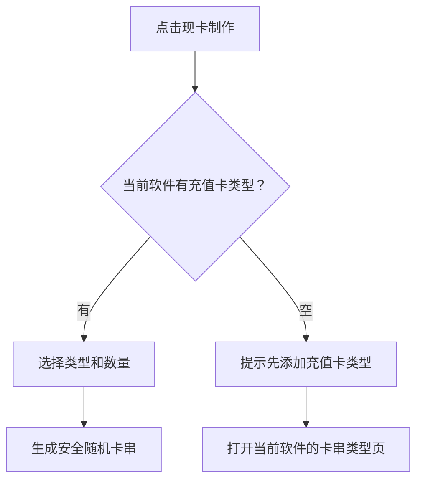

# 软件用户与现卡流程

## 1. 软件卡片操作

每个软件固定显示五个业务入口：

1. **软件配置**：基本配置、通信安全、限开控制。
2. **用户管理**：按软件模式显示卡串用户或账户用户。
3. **充值卡列表**：当前软件的库存、已发出、已激活卡串。
4. **卡串类型**：建立时长、点数或固定到期类型。
5. **现卡制作**：选择类型后批量生成安全随机卡号/密码。

首版界面精简项：

- 移除用户分组。
- 移除卡类图片。
- 卡类型与现卡制作按当前软件过滤。
- 充值卡类型保留面值和代理默认价。
- 卡串类型使用独立软件工作页，不挂入全局卡密一级菜单。
- 类型页不显示“全部卡密/库存/已发出/已激活”统计，表单卡片铺满右侧内容区。

## 2. 两种用户管理模式

### 卡串验证限时模式

用户实体是已发出的卡串：

- 脱敏卡号与 ULID。
- 卡串类型。
- 已发出/正常/冻结/过期/作废状态。
- 发出、激活和到期时间。
- 绑定设备标识。

### 账号登录限时模式

用户实体是独立软件账户：

- 用户名与 ULID。
- 正常/冻结/过期状态。
- 到期时间。
- 余额和点数。
- 最后登录时间、登录次数。
- 绑定设备标识。

`application_accounts` 已作为 W7 `registration.lg/login.lg/chong.lg` 的数据基础。

## 3. 现卡制作前置规则

- 每批 1–500 张。
- 卡号与密码使用系统随机源。
- 明文在创建成功后展示一次。
- 后续列表仅显示脱敏卡号。
