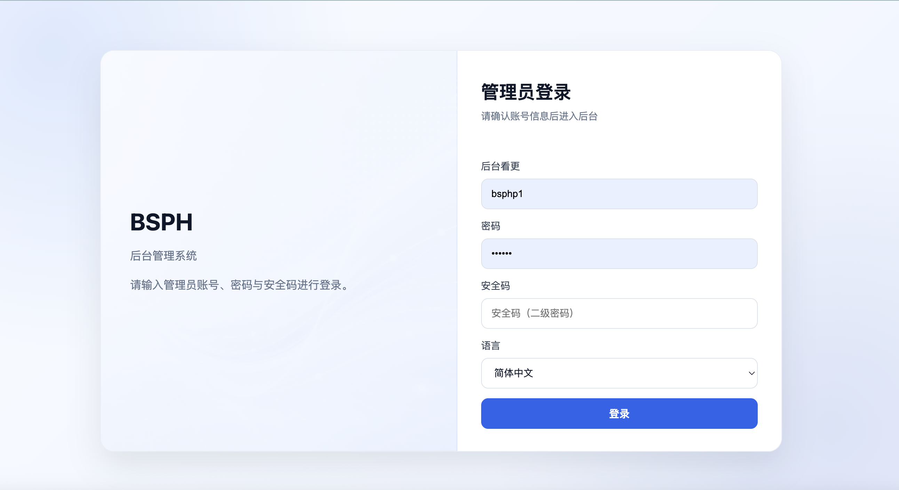
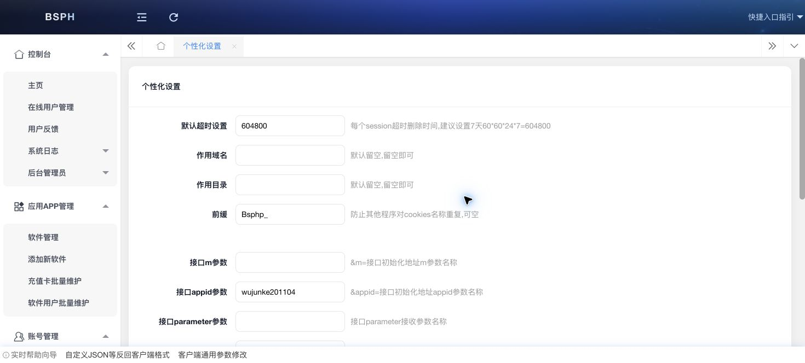
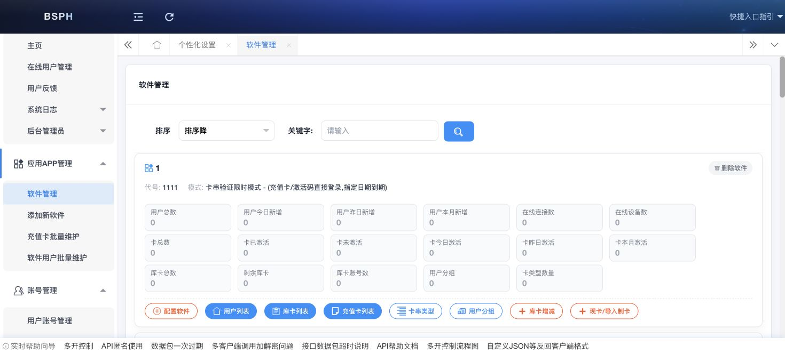

# BSPHP 在线后台 UI 调研

新版整体视觉规范已经单独整理在
[UI_STYLE_GUIDE.md](UI_STYLE_GUIDE.md)，采用“现代蓝白管理台”方向。

> 调研日期：2026-07-18  
> 调研范围：登录页、后台框架、个性化参数页、软件管理页。  
> 用途：提取信息架构和高价值交互，不直接复制旧页面源码。

## 1. 参考截图

### 登录页



结构：

- 居中大卡片，左右分栏。
- 左侧品牌、系统说明。
- 右侧管理员账号、密码、安全码、语言和登录按钮。
- 浅蓝灰背景、蓝色主按钮、较大的输入区域。

新版处理：

- 保留左右分栏和清晰品牌区。
- 手机端折叠成单列。
- 首版确定不使用验证码。
- 首版语言先使用简体中文。
- “安全码（二级密码）”是否进入新版登录，单独确认；它与图形验证码不是同一概念。

### 后台框架



结构：

- 深蓝色顶栏。
- 左侧多级折叠菜单。
- 顶部页签。
- 主内容由 iframe 加载。
- 底部有实时帮助向导。

新版处理：

- 保留左侧分组导航、当前页状态和操作入口。
- 桌面端保留侧栏；手机端改为抽屉与底部导航。
- 使用 Laravel 正常路由和 Blade Layout，不继续使用 iframe 页签。
- 帮助内容改成页面右侧说明或帮助抽屉。

### 软件管理



软件以大卡片展示，每个应用卡片含：

- 应用名称、代号、授权模式。
- 用户总数、今日/昨日/本月新增。
- 在线连接数、在线设备数。
- 卡总数、已激活、未激活、今日/昨日/本月激活。
- 原版展示库卡总数、剩余库卡、库卡账户数；新版不采用这套概念。
- 用户分组和卡类型数量。
- 原版包含配置软件、用户列表、库卡列表、充值卡列表、卡类型、用户分组、
  库卡增减、现卡/导入制卡等入口。

这个页面的信息设计值得保留，但新版会减少同屏密度：

- 应用列表先显示核心指标。
- 详细统计放入应用详情。
- 常用动作放主按钮。
- 低频动作放“更多”菜单。
- 手机端每个应用显示为可折叠卡片。

范围修正：

- 移除“库卡列表”“库卡增减”“库卡归零”和“库卡账户”入口。
- 保留卡密管理、卡种、批次、生成/导入、手动发卡和代理提卡。
- 可用库存是普通卡密状态的统计结果，不作为单独业务模块展示。

## 2. 在线后台菜单地图

### 控制台

- 主页
- 在线用户管理
- 用户反馈
- 系统日志
- 后台管理员

### 应用 APP 管理

- 软件管理
- 添加新软件
- 充值卡批量维护
- 软件用户批量维护

### 账号管理

- 用户账号管理
- 代理账号管理
- 添加账号
- 批量维护

### 系统配置

- 系统信息设置
- 个性化设置
- 验证码设置
- 账号注册设置
- 用户扩展字段
- 邮件设置
- 短信设置
- 云存储设置
- 邀请推广设置
- 在线支付设置
- 全球化语言设置
- 代理商平台设置
- 代理导航菜单控制
- 三方插件配置

### 文章公告

- 文章列表/添加
- 栏目列表/添加

### 卡信息统计

- 按账户、代理、备注统计
- 批量统计

### 充值营销

- 余额充值订单
- 平台购卡订单
- 邀请推广
- 佣金
- 余额日志

### 运营工具

- API 匿名加解密
- WEBAPI
- API 帮助
- API 调试工具
- 批量封卡/解冻/删除
- 添加 App 用户

## 3. 首版菜单收敛

根据已确认范围，新版首版菜单：

```text
概览
应用
  应用列表
  新建应用
  协议与响应
  风控策略
卡密
  卡种
  批次
  卡密列表
  手动发卡
  导入/导出
账户
  用户账户
  账户充值记录
代理
  代理账户
  代理等级
  权限模板
  余额与提卡记录
在线与风险
  在线会话
  登录事件
  风险事件
日志
  管理日志
  卡密操作日志
  API 日志
系统
  基础设置
  后台路径
  Legacy 参数名
  管理员与角色
```

首版不显示：

- 支付与订单。
- 邮件和短信。
- 图形验证码。
- 邀请推广与佣金。
- 文章栏目。
- 云存储。

## 4. 个性化参数设计

在线后台允许修改以下 Legacy 参数名：

- `m`
- `appid`
- `parameter`
- `mutualkey`
- `api`
- `date`
- `md5`
- `BSphpSeSsL`
- `appsafecode`

这是旧版值得保留的高级能力。新版建议分成两层：

1. **系统默认参数名**
2. **应用覆盖参数名**

后台修改前展示客户端示例，保存后生成新的 Objective-C/PHP/cURL 调用片段，并保留修改日志。

## 5. UI 实现原则

- 参考旧版的信息结构，不照搬旧 CSS 和 iframe 技术。
- 登录页继续使用左右分栏视觉，手机端单列。
- 应用页以卡片作为主对象。
- 列表页支持筛选、批量操作和导出。
- 危险操作与常规操作分组。
- 代理看见的按钮由权限决定。
- 每个配置页同时显示说明和默认值。
- 高级协议项默认折叠，减少误改。

## 6. 仍需继续调研的页面

- 新建/配置软件。
- 卡类型和制卡。
- 用户列表。
- 代理列表与代理菜单权限。
- 在线用户。
- 反破解日志/API 调试。

这些页面在对应大目标开始前逐页调研，不在当前阶段一次性抓取全部页面。
