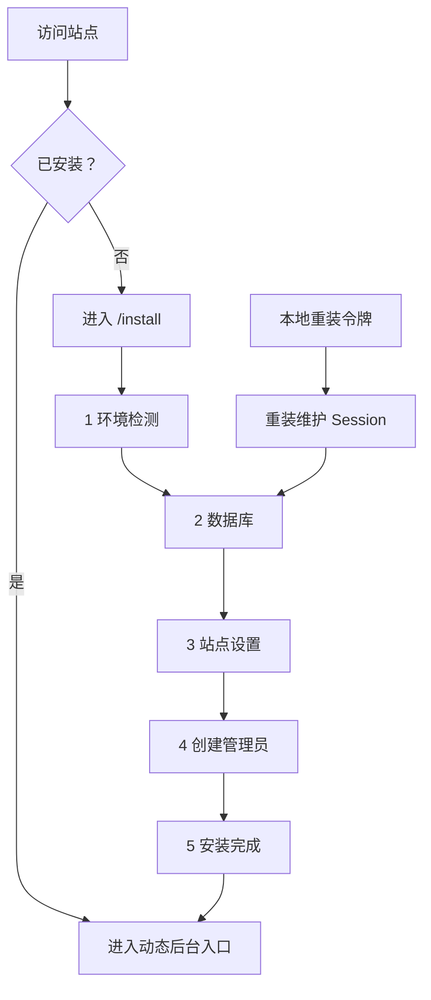

# W2 首次安装与管理员登录页面规格

> 状态：W2-0 冻结
>
> 日期：2026-07-19
>
> 后续实现：W2-1～W2-11

## 1. 目标

本规格把旧版 BSPHP 的首次安装、可变后台入口和管理员登录习惯迁入 Laravel，
同时固定新版的页面流程、字段、状态、错误、响应式和验收边界。

W2-0 只冻结交互与验收契约；数据库、路由、中间件和认证业务从 W2-1 开始逐项实现。

## 2. 调研证据

| 来源 | 证据 | 结论 |
|---|---|---|
| 旧版入口 | `示例/index.php` | 缺少 `Data/install.txt` 时自动进入安装器 |
| 旧版安装器 | `示例/install/` | 包含环境检测、MySQL、表前缀、导入和安装标记 |
| 旧版后台入口 | `示例/nnnnnnnnnnxxx/index.php` | 外部目录可变，内部仍属于 Admin 模块 |
| 8090 原型 | `resources/views/install/wizard.php` | 已形成环境、数据库、站点、管理员、完成五步流程 |
| 覆盖安装 | `docs/REINSTALL.md` | 非空数据库默认停止；覆盖需二次确认；重装需本地一次性令牌 |
| 二级密码 | `docs/decisions/W0-8_ADMIN_SECONDARY_PASSWORD.md` | 全局开关默认关闭，账号级可要求二级密码 |
| 在线登录参考 | `docs/assets/bsphp-login-reference.png` | 蓝白左右分栏、右侧大表单、桌面信息清楚 |
| 当前登录原型 | `resources/views/admin/login.php` | 已有动态二级密码、统一错误、频率限制提示和手机单列 |
| 实际在线后台 | `https://app.bsphp.com/admin/` | 已确认旧版使用侧栏、页签和 iframe；新版只借鉴信息结构 |

2026-07-19 的浏览器复查结果：

- 在线 BSPHP 登录参考仍采用左品牌、右表单、浅蓝背景和蓝色主按钮。
- 当前 8090 登录页只包含管理员账号、密码、二级密码和登录按钮，语言选择已经移除。
- 1280px 页面为左右分栏；390px 隐藏左侧视觉区，表单宽 346px，按钮高 54px。
- 390px 页面无横向溢出，浏览器控制台无 error / warn。

## 3. 已冻结产品决策

1. 默认后台入口为 `/admin`，安装时允许改成自定义路径。
2. 初始超级管理员账号默认填入 `admin`，安装者可以重写。
3. 管理员主密码最少 6 位，最多 128 位；页面建议使用 12 位以上组合密码。
4. 二级密码保留为可选功能，首次安装默认关闭。
5. 开启二级密码时，初始管理员必须填写二级密码及确认值，两者均为 6～128 位。
6. 登录页首版固定简体中文，移除语言选择器。
7. 登录与安装流程移除邮箱、短信、图形验证码和在线支付字段。
8. 安装锁、环境配置和数据库状态共同参与重复安装保护。
9. 非空数据库默认停止；只有明确选择覆盖并完成最终二次确认后才执行清理。
10. 页面使用 Modern BSPHP Blue 设计语言；旧版 iframe、固定桌面宽度和旧 CSS 退出实现。

## 4. 安装状态与跳转



### 4.1 状态规则

| 状态 | `/` | `/install` | 动态后台入口 |
|---|---|---|---|
| 未安装 | 302 到 `/install` | 显示步骤 1 | 302 到 `/install` |
| 安装中 | 302 到当前安装步骤 | 显示 Session 中的当前步骤 | 302 到 `/install` |
| 已安装 | 显示站点首页，不公开后台入口 | 返回 404 安装锁定页 | 未登录显示登录页 |
| 重装已授权 | 按维护策略展示 | 显示重装提示并从数据库步骤开始 | 保持现有登录入口 |

出现任一已安装信号时，普通请求都进入安装锁定状态：

- `storage/installed.lock` 存在。
- 环境配置中的安装状态为真。
- 数据库安装元数据表存在有效完成记录。

三者状态不一致时进入维护诊断，不直接开放覆盖安装。

## 5. 安装向导总体布局

### 5.1 桌面

- 页面背景使用 `#F3F6FC` 到极浅蓝渐变。
- 主面板宽度 960～1120px，白色背景，12px 圆角。
- 顶部为品牌、`步骤 X / 5` 和横向步骤条。
- 内容区最大宽度 720px，居中展示当前步骤。
- 单页只保留一个主要动作，次要动作位于左侧或主按钮之前。
- 错误摘要固定在标题和表单之间，避免推动页面结构大幅变化。

### 5.2 手机

- 390px 使用单列页面，左右边距 16～22px。
- 步骤条变为紧凑横向进度或“步骤 X / 5 + 当前标题”。
- 每个输入框、按钮和可点击控件高度至少 44px。
- 主按钮占满内容宽度。
- 表单字段不组成两列；数据库地址和端口也分成上下两项。
- 页面无横向滚动，软键盘打开后主要动作仍可滚动到达。

## 6. 五步安装流程

### 6.1 步骤 1：环境检测

页面说明：安装前确认 Laravel 运行环境、扩展和目录权限。

必需检查：

| 项目 | 通过条件 |
|---|---|
| PHP | `>= 8.3` |
| PDO / PDO MySQL | 扩展加载 |
| OpenSSL | 扩展加载 |
| Mbstring | 扩展加载 |
| JSON | 可用 |
| Ctype / Tokenizer / XML | Laravel 依赖可用 |
| `storage/` | 可写 |
| `bootstrap/cache/` | 可写 |
| 环境配置目录 | 可创建临时配置并原子替换 |

建议检查：

- 生产环境使用 HTTPS。
- `APP_DEBUG` 在生产安装后关闭。
- PHP 时区与站点时区设置明确。

交互：

- `重新检测`：刷新全部项目。
- `下一步`：仅在全部必需项目通过时启用。
- 每项显示名称、检测值、`通过 / 未通过 / 建议` 状态。
- 失败项提供可操作说明，不输出服务器目录之外的额外环境信息。

### 6.2 步骤 2：连接数据库

| 字段 | 默认值 | 规则 |
|---|---|---|
| 数据库地址 | `127.0.0.1` | 必填，主机名或 IP |
| 端口 | `3306` | 1～65535 |
| 数据库名称 | `mybsphp` | 1～64 位字母、数字、下划线 |
| 数据库用户名 | `root` | 必填 |
| 数据库密码 | 空 | 密码输入，不回填到 HTML |
| 数据库不存在时自动创建 | 开启 | 账号缺少建库权限时给出明确结果 |
| 覆盖现有数据库 | 关闭 | 危险开关 |

主要动作：`测试连接并继续`。

返回状态：

1. 连接成功且数据库为空：进入步骤 3。
2. 数据库不存在且允许创建：创建后进入步骤 3。
3. 数据库不存在且关闭创建：提示创建数据库或开启自动创建。
4. 账号、密码、主机或端口异常：显示统一安全提示，日志记录异常类别并完成脱敏。
5. 数据库非空：默认停止，显示“选择其他数据库”与“覆盖现有数据库”。

原始 PDO 异常、连接密码、完整 DSN 和服务器堆栈不进入页面响应。

### 6.3 步骤 3：站点设置

| 字段 | 默认值 | 规则 |
|---|---|---|
| 站点名称 | `MyBsPHP2` | 1～80 字符 |
| 站点地址 | 当前访问地址 | 完整 HTTP/HTTPS URL，保存时移除末尾 `/` |
| 时区 | `Asia/Shanghai` | 首版使用配置项，页面默认当前选择 |
| 后台入口 | `admin` | 3～48 位字母、数字、短横线或下划线 |

后台入口规则：

- 保存值不包含前导或末尾 `/`。
- 大小写统一按小写保存。
- `install`、`api`、`assets`、`storage`、`vendor` 和框架健康检查路径属于保留值。
- 页面实时展示最终地址，例如 `https://example.com/nnnnnnnnnnxxx`。
- 修改入口用于减少无目的扫描；页面同时提示继续使用高强度密码和登录限流。
- 安装完成页提供复制入口按钮。

主要动作：`保存站点设置`。

### 6.4 步骤 4：创建管理员

基础字段：

| 字段 | 默认值 | 规则 |
|---|---|---|
| 管理员用户名 | `admin` | 3～32 位字母、数字、点、短横线或下划线 |
| 管理员密码 | 空 | 6～128 位 |
| 确认管理员密码 | 空 | 与主密码一致 |
| 启用二级密码 | 关闭 | 全局安装开关 |
| 二级密码 | 隐藏 | 开启后显示，6～128 位 |
| 确认二级密码 | 隐藏 | 开启后显示并校验一致 |

交互规则：

- 密码输入支持“显示 / 隐藏”，默认隐藏。
- 主密码显示强度提示；最少 6 位是提交门槛。
- 二级密码开关关闭时，初始管理员的二级密码哈希为 `null`，账号级要求为假。
- 二级密码开关开启时，两个二级密码字段立即显示并成为必填。
- 主密码与二级密码相同则提示重新设置。
- 安装页面不显示任何密码原文摘要。

当步骤 2 选择覆盖数据库时，本页追加危险确认区：

1. 展示即将清理的数据库名称。
2. 要求手动输入完整数据库名。
3. 要求勾选“确认清除并重新安装”。
4. 主要按钮文字变为 `确认覆盖并安装`。

普通安装的主要按钮为 `完成安装`。

### 6.5 步骤 5：安装完成

显示：

- 安装成功状态。
- 站点名称。
- 后台完整入口。
- 管理员用户名。
- 二级密码状态：`关闭` 或 `已启用`。
- `复制后台入口` 与 `进入管理后台`。

隐藏：

- 数据库密码。
- 主密码和二级密码。
- 应用密钥。
- 数据库连接串。

只有迁移、管理员与角色绑定、环境配置和安装锁全部成功后才显示本页。

## 7. 安装写入顺序与失败恢复

正式安装按以下顺序执行：

1. 再次验证 Session 中的数据库、站点和管理员数据。
2. 对覆盖安装再次验证数据库名和确认框。
3. 创建或选择数据库。
4. 执行 Laravel Migration。
5. 在数据库事务中创建超级管理员并绑定 `super_admin`。
6. 写入临时环境配置并原子替换正式配置。
7. 写入安装完成元数据和 `storage/installed.lock`。
8. 轮换安装 Session，进入完成页。

失败规则：

- 管理员或角色绑定失败时事务回滚，避免残留 `admin` 导致重试出现唯一索引冲突。
- 环境配置或安装锁失败时不展示成功页。
- 已执行的 Migration 允许安全重试。
- 页面保存非敏感字段；数据库密码、主密码和二级密码要求重新输入。
- 每次失败产生请求 ID，页面显示简洁提示，详细类别进入脱敏日志。

## 8. 覆盖安装与重装

### 8.1 非空数据库

- 首次发现非空数据库时只记录覆盖意图，不立即清理。
- 最终清理发生在步骤 4 的二次确认之后。
- 覆盖确认在刷新或返回步骤 2 后重新验证。

### 8.2 已安装站点

- 普通访问 `/install` 返回 404 安装锁定页，不展示动态后台入口。
- 服务器本地命令生成短时一次性重装 URL。
- 令牌成功换取安装 Session 后立即消费。
- 页面显示“重装维护模式已授权”横幅。
- 重装默认选择覆盖，但最终数据库名和确认框仍需填写。
- 安装成功后清理重装授权并写入新安装锁。

完整操作规则沿用 [`REINSTALL.md`](REINSTALL.md)。

## 9. 管理员登录页面

### 9.1 页面路由

假设安装时设置：

```text
admin_path = nnnnnnnnnnxxx
```

则：

| 请求 | 行为 |
|---|---|
| `GET /nnnnnnnnnnxxx` | 未登录显示登录页；已登录进入后台首页 |
| `POST /nnnnnnnnnnxxx/login` | 提交登录 |
| `POST /nnnnnnnnnnxxx/logout` | 注销并返回动态入口 |
| `GET /admin` | 自定义入口生效后返回 404 |
| `GET /install` | 已安装时返回 404 安装锁定页，不公开后台入口 |

登录提交入口跟随动态后台路径，避免固定认证地址绕过入口定制。
若 W2-7 同时提供 JSON 认证入口，其地址为
`/{admin_path}/api/auth/login`，继续位于动态后台路由组内。

### 9.2 桌面布局

沿用在线 BSPHP 登录页的高价值结构：

```text
浅蓝页面背景
┌─────────────────────────────────────────────┐
│ 品牌与系统说明 50% │ 管理员登录表单 50%     │
│ BSPH / MyBsPHP2    │ 管理员账号              │
│ 后台管理系统       │ 密码                    │
│ 简短业务说明       │ 条件显示的二级密码      │
│                    │ 登录按钮                │
└─────────────────────────────────────────────┘
```

正式版调整：

- 品牌统一显示 `MyBsPHP2`，保留小型 `BS` 标记。
- 移除语言选择。
- 二级密码只在全局开关开启时显示。
- 左侧文案保持简洁，不使用超大艺术字体。
- 右侧表单宽度 420～520px，输入和按钮高度 48～54px。

### 9.3 手机布局

- 390px 隐藏桌面左侧视觉面板。
- 顶部显示紧凑品牌。
- 表单占满可用宽度。
- 顺序固定为标题、错误、账号、密码、条件二级密码、登录按钮、安全提示。
- 按钮高度至少 48px。
- 页面不出现底部导航或后台侧栏。

### 9.4 字段和交互

| 字段 | 规则 |
|---|---|
| 管理员账号 | 必填；失败后可以保留转义后的账号值 |
| 密码 | 必填；`autocomplete=current-password` |
| 二级密码 | 全局开关开启时显示；服务端继续按账号级要求判定 |

登录页移除：

- 邮箱和找回密码入口。
- 图形验证码、短信码和邮件码。
- 语言选择。
- 记住密码或长期登录选项。

提交状态：

- 点击后按钮显示 `正在登录…` 并锁定重复提交。
- Enter 可以提交。
- CSRF 或 Session 过期显示“页面已刷新，请重新登录”。
- 失败后密码字段清空并聚焦首个需要修正的字段。

### 9.5 登录结果

| 情况 | 页面结果 |
|---|---|
| 账号、主密码或二级密码错误 | 统一显示“登录信息不正确” |
| 账号停用或冻结 | 使用相同失败提示，详细原因进入审计 |
| 达到限流阈值 | 显示稍后重试及剩余秒数 |
| 登录成功 | 轮换 Session ID，写审计，进入动态后台首页 |
| 已登录再次访问登录入口 | 进入动态后台首页 |
| 注销 | 清理认证状态、轮换 Session，返回动态入口 |

主密码和二级密码失败共同计入账号与来源 IP 两个限流维度。

## 10. 页面通用状态

安装器和登录页都必须覆盖：

| 状态 | 表现 |
|---|---|
| 默认 | 表单可操作，主按钮清楚 |
| 加载 | 按钮内进度，阻止重复提交 |
| 字段错误 | 字段附近说明，`aria-invalid=true` |
| 页面错误 | 标题下方错误摘要，带请求 ID |
| 服务异常 | 保留非敏感输入，可重新提交 |
| Session 过期 | 返回对应步骤或登录页，说明重新提交 |
| 成功 | 明确下一步，不自动跳走导致入口来不及保存 |

## 11. 响应式与可访问性验收

检查尺寸：

- 390 × 844。
- 768 × 1024。
- 1280 × 800。
- 1440 × 900。

全部页面满足：

1. 无横向溢出。
2. 主操作可通过键盘到达，Focus 样式清楚。
3. 输入框具有可见 Label，错误与帮助文本通过 `aria-describedby` 关联。
4. 错误摘要使用 `role=alert`，提交失败后获得焦点。
5. 颜色不作为唯一状态信息。
6. 文本和背景达到 WCAG AA 对比度。
7. 支持 `prefers-reduced-motion`。
8. 密码显示按钮具有动态 `aria-label` 和 `aria-pressed`。

## 12. W2 任务映射

| 任务 | 本规格对应内容 | 必须产生的证据 |
|---|---|---|
| W2-1 | 第 4 节状态和跳转 | 未安装/已安装 Feature 测试 |
| W2-2 | 6.1 环境检测 | 检查器 Unit + 页面 Feature |
| W2-3 | 6.2 数据库步骤 | 连接、建库、非空库、脱敏测试 |
| W2-4 | 6.3 站点名称、URL、时区、默认入口 | 校验与默认值测试 |
| W2-5 | 6.3、9.1 动态后台路径 | 新旧路径路由测试 |
| W2-6 | 6.4、7 管理员与角色事务 | 创建、回滚、唯一约束测试 |
| W2-7 | 第 9 节登录/退出 | 成功、失败、Session 轮换测试 |
| W2-8 | 二级密码开关与条件字段 | 关闭、可选、强制测试 |
| W2-9 | 9.5 限流和失败延迟 | 账号/IP 维度与重试时间测试 |
| W2-10 | 第 7、8 节锁和覆盖 | 重复安装、覆盖、令牌、失败恢复测试 |
| W2-11 | 第 5、9、10、11 节 UI | 390/768/1280/1440 浏览器证据 |

## 13. W2-0 完成条件

- 旧版安装器、可变后台入口和在线登录页均有来源记录。
- 安装五步流程、字段、默认值、校验和错误状态已经冻结。
- 管理员主密码最少 6 位、可选二级密码和动态后台入口规则已经冻结。
- 语言、邮箱、短信、图形验证码和支付字段已从 W2 页面范围移除。
- 覆盖安装、重复管理员、安装锁和重装授权均有明确交互。
- 每一项 W2-1～W2-11 都能追溯到本规格中的页面或状态要求。
