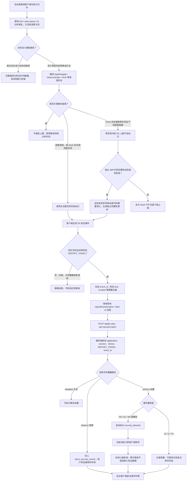
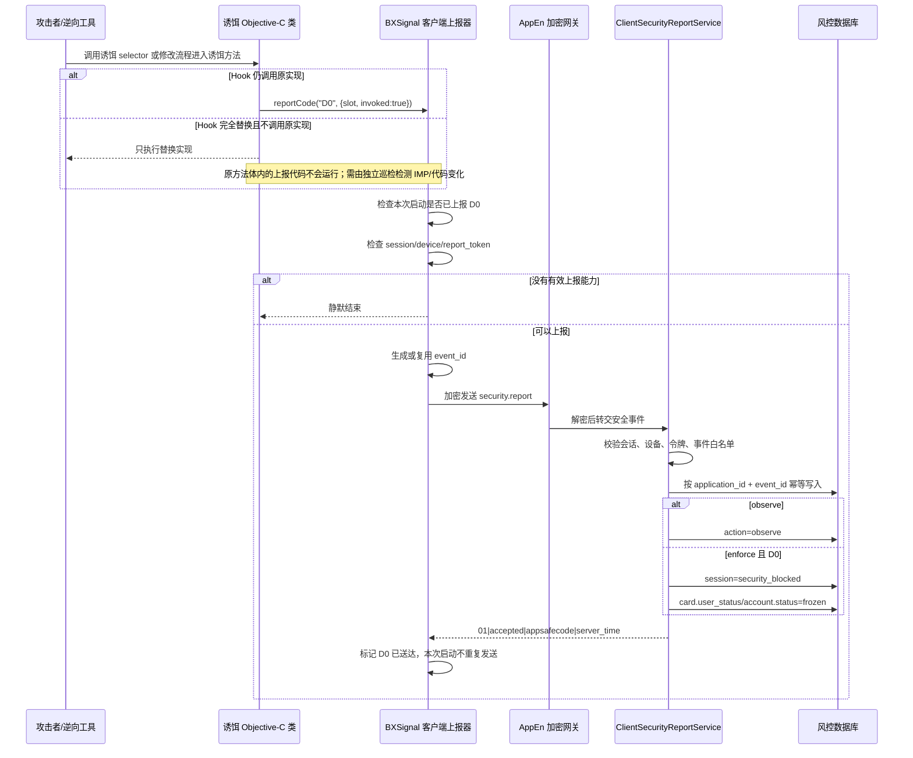
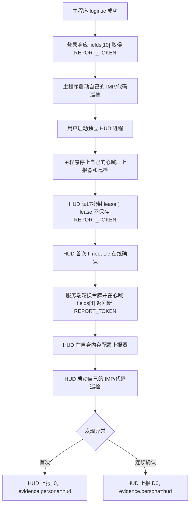

# 客户端蜜罐触发与服务端处置流程图

## 1. 总体流程

## 2. 当前 D0 诱饵触发链

## 3. 事件入口说明

| 事件 | 典型触发方式 | 当前处置 |
|---|---|---|
| `D0` | 诱饵类或诱饵 selector 被实际调用 | `enforce` 下阻断会话并冻结授权主体 |
| `D1` | 诱饵资源、伪配置或伪路由被实际请求 | `enforce` 下阻断会话并冻结授权主体 |
| `R0` | 出现正常服务端永远不会下发的 RVA/能力组合 | `enforce` 下阻断会话并冻结授权主体 |
| `I0` | 主程序或加载命令摘要异常 | 记录观察 |
| `I1` | 密封数据完整性标签失败 | 记录观察 |
| `T0` | 调试、Hook 或注入迹象 | 记录观察 |

## 4. 关键边界

1. 仅使用 IDA 或 class-dump 静态浏览不会直接触发。
2. 当前 D0 写在诱饵方法原实现内部：直接调用或 Hook 后继续调用原实现会触发；完全替换实现且不回调原函数时，该 D0 不会运行。
3. 若要识别“只替换、不执行原函数”的 Hook，需要在诱饵方法之外增加独立的 Objective-C IMP/代码完整性巡检，并从独立上报器发送事件。
4. 没有蜜罐的应用、旧客户端和关闭模式不要求上报，静默不会被当成攻击。
5. 客户端只上传事件代码和摘要；风险等级、观察或冻结动作由服务端决定。
6. `event_id` 保证网络重试不会重复处罚。
7. 推荐先使用 `observe` 查看真实命中，再对稳定的 `D0/D1/R0` 开启 `enforce`。

## 5. Hook 行为与当前结果

| 行为 | 当前是否上报 |
|---|---|
| 正常流程从不调用诱饵 | 否 |
| 攻击者直接调用诱饵 selector | 是，原方法执行并发送 `D0` |
| Hook 后调用 `%orig`/原 IMP | 是，执行原实现时发送 `D0` |
| Hook 完全替换原实现，不调用原 IMP | 否，方法体内的发送逻辑被一起绕过 |
| 只安装 Hook，但从未调用该 selector | 当前否；独立 IMP 巡检可以识别 |
| 同时屏蔽上报网络 | 事件发送不出去；服务端只能依赖短期租约、心跳和按需数据返回 |

## 6. 当前实现状态与误判控制

- 已实现：诱饵方法原实现内部发送 `D0`。
- 已实现：服务端 `disabled/observe/enforce` 三档处理。
- 已实现：诱饵方法外部的 IMP 与前 32 字节代码指纹周期巡检。
- 已实现：主程序与 HUD 两个进程分别取得短期上报令牌、分别运行巡检。

当前只检查自有诱饵类，不检查 UIKit 和业务类。第一次异常发送服务端固定观察的 `I0`；连续两轮仍异常，并且新 IMP 位于主程序镜像外，或原 IMP 地址未变但代码字节被改写时，才发送 `D0`。首次巡检约在启动后 2 秒，之后约每 15 秒一次。上线前仍建议保持服务端 `observe`，积累正常设备数据后再开启 `enforce`。

## 7. 主程序与 HUD 双进程流程

主程序使用登录响应令牌；HUD 使用首次成功心跳返回的新令牌。令牌不通过磁盘 lease 跨进程传递，避免把上报令牌写入共享缓存。服务端每次成功心跳轮换令牌，旧令牌立即失效。
